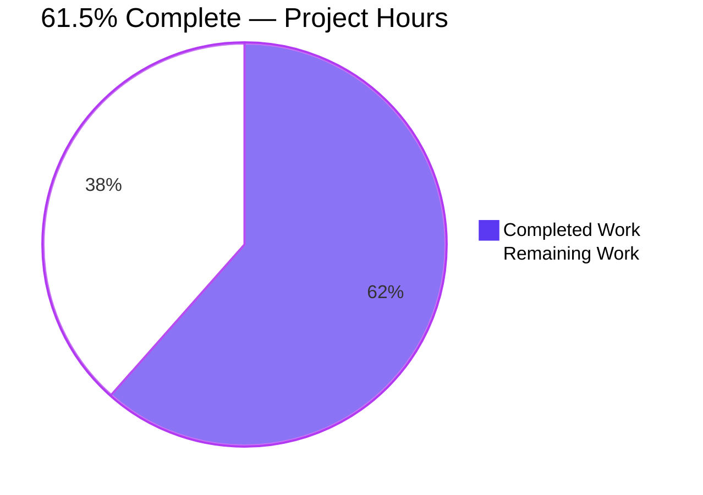
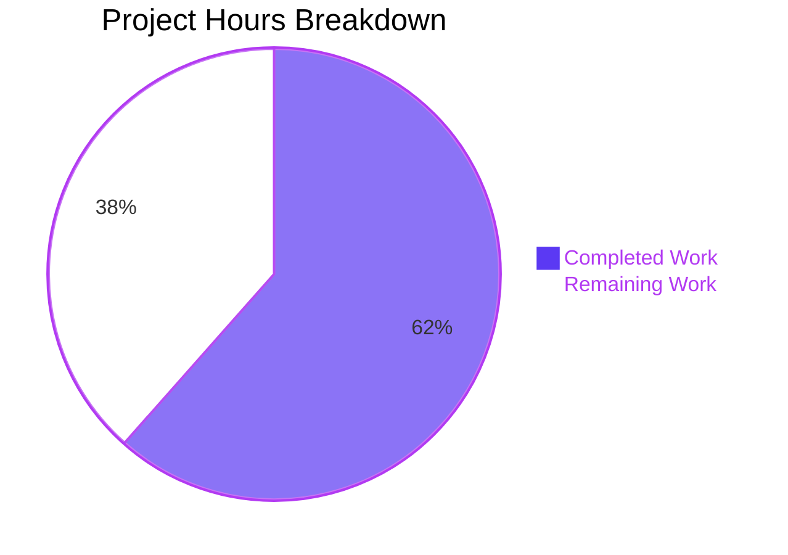

# 1. Executive Summary

## 1.1 Project Overview

A front-page documentation release for the Python Flask tutorial service: `README.md` was reduced to the three things a new reader needs — the project name, the install command and the run command — replacing 1,001 lines of accumulated tutorial material. The reader is a developer or operator opening the repository cold; the technical scope is one file of four lines, plus the verification that proves it correct. The service it documents is a Flask application serving `/hello` and `/health`.

## 1.2 Completion Status



| Metric | Hours |
|---|---|
| Total Hours | 26.0 |
| Completed Hours (AI + Manual) | 16.0 (16.0 autonomous, 0.0 manual) |
| Remaining Hours | 10.0 |

Completion = completed ÷ total = 16.0 ÷ 26.0 = **61.5%**.

## 1.3 Key Accomplishments

- [x] The front page carries exactly the project name, install command and run command — 4 lines, 139 bytes, byte-for-byte the specified content (`README.md`).
- [x] Confined to that one file: two insertions, 1,001 deletions, nothing added, deleted, renamed or reformatted.
- [x] The documented startup command boots the service on `127.0.0.1:5000`, and every route answers: `/hello` 200, `/health` 200, unrouted 404, wrong method 405.
- [x] The environment path works end to end from a fresh environment: the resolved dependency set installs cleanly (96 distributions) and the service then serves.
- [x] The regression baseline is measured and unchanged: the module compiles, and lint and security-scan totals match the pre-change baseline.

## 1.4 Critical Unresolved Issues

14 open records remain, spanning both elements the request named and the repository the front page documents.

| Issue | Impact | Owner | ETA |
|---|---|---|---|
| Documented runbook — 3 records: the install command cannot complete (two absent dependency names); neither command establishes a virtual environment, so a locked-down host refuses the install; the commands are labelled prose pending a form decision | A new reader cannot install the service, and cannot paste and run the commands as printed | Documentation owner / requester authorisation | Next release |
| Requested source-comment element — 1 record: no `server.js` and no JavaScript exists in the checkout | One of the two requested elements is absent from the repository; nothing can be written for it without the file | Requester | Decision |
| Release gate — 2 records: the suite ends 11 failed / 11 errors / 0 passed with a host-sensitive outcome; the declared coverage gate is 100% against 61.68% measured | No automated release signal; regressions cannot be distinguished from host noise | QA owner | Hardening cycle |
| Gate configuration — 3 records: both `pytest.ini` files unparseable; `.flake8` unreadable by flake8 7.x; the CI lint and test steps cannot succeed and its matrix covers 3.10–3.12 against a `>=3.12` project | Quality gates cannot run as configured in the tree or in CI | Build owner | Hardening cycle |
| Runtime and deployment — 3 records: SIGINT/SIGTERM are absorbed so the development server cannot be stopped normally; the WSGI banner reports `0.0.0.0:8000` against a `127.0.0.1:5000` bind; the production container command targets `gunicorn wsgi:app` while the module exports `application` | Operators cannot stop the development server cleanly, and a container built from the shipped command would fail to resolve the application | Backend / operations owner | Hardening cycle |
| Documentation surface — 2 records: a stale tracked project-status document still describes the pre-migration Node.js layout; a second README and the contributing guidance describe material the front page no longer carries | Reader-facing documentation contradicts the tree | Documentation owner | Next release |

## 1.5 Access Issues

No access issues identified — the repository, the Python 3.13 toolchain, the package index and local ports were all reachable.

## 1.6 Recommended Next Steps

1. **[High]** Authorise the dependency-manifest correction and confirm the documented install completes in a clean environment.
2. **[High]** Authorise the environment step inside the two documented commands and re-verify both from a clean checkout.
3. **[Medium]** Settle the runbook's final presentation and declare the Python version prerequisite it omits.
4. **[Medium]** Repair the release gate: stabilise the suite, correct the coverage target, and make the shipped configuration and CI steps runnable.
5. **[Low]** Ratify the disposition of the requested source-comment element and reconcile the stale status document with the delivered front page.

# 2. Project Hours Breakdown

## 2.1 Completed Work Detail

| Component | Hours | Description |
|---|---|---|
| Root README authoring and in-place replacement | 3.0 | Drafting the four-line front page from the repository's own project title, install command and run command, and replacing the existing file's content with it |
| Content acceptance verification | 4.0 | Byte-exact comparison against the specified content, digests, line and element counts, extra-content and exclusion probes over every excluded class, Markdown well-formedness, structural integrity and content-safety sweeps |
| Change-scope and repository-integrity verification | 2.5 | Diff against the base revision, tracked-file census, confirmation that nothing was added, deleted, renamed or reformatted, and that no manifest, configuration, test, dependency or documentation reference changed |
| Documented install and run values exercised end to end | 4.0 | Install reproduction in a clean environment with control experiments, startup of the documented command, HTTP contract checks, repeated and short-burst requests, and lifecycle probes |
| Backend regression baseline and quality-gate measurement | 2.0 | Whole-module compile, lint and security scans, full test-suite run with coverage, and comparison against the pre-change tree |
| Disposition of the requested source-comment element | 0.5 | Establishing that the file the comment belongs to does not exist in the checkout and recording the element as undeliverable |
| **Total** | **16.0** | |

## 2.2 Remaining Work Detail

| Category | Hours | Priority |
|---|---|---|
| Make the documented install resolve — correct the two dependency declarations that do not exist on the package index (four declaration sites) and re-verify the install in a clean environment | 3.0 | High |
| Add the environment step to the two documented commands and re-verify both from a clean checkout | 3.0 | High |
| Settle the runbook's final presentation and declare the Python version prerequisite it omits | 1.5 | Medium |
| Reconcile the stale project-status document and the second README's older instructions with the delivered front page | 1.0 | Medium |
| Release sign-off — re-run the documented workflow end to end on the corrected tree and publish | 1.0 | Medium |
| Ratify the disposition of the requested source-comment element (no target file exists) | 0.5 | Low |
| **Total** | **10.0** | |

## 2.3 Hours Basis and Exclusions

Hours are engineering effort for the scoped work, from the delivered change's measured size and the verification it required: one four-line file (two inserted lines, 1,001 deleted) plus the byte-exactness, structure, scope, content-safety, runtime, lifecycle and regression-baseline checks recorded in Sections 3 and 4. Completed hours cover work present in the tree at `dcca5cf`; remaining hours cover only the items traced above to the delivered documentation and its path to a usable release.

Deliberately outside the 26.0-hour denominator, and therefore carrying no hours against this project's completion: the repository's pre-existing test-suite and gate state (failing suite, host-sensitive outcome, 100% coverage target against 61.68% measured, unparseable `pytest.ini` files, `.flake8` unreadable by flake8 7.x, CI steps that cannot succeed) and the pre-existing runtime and deployment defects named in Section 1.4. None of these was created by, reachable from, or fixable within a documentation-only change; they are separately scoped work for the repository owners and are assessed in Sections 3, 4 and 6.

# 3. Test Results

| Area / Category | Framework | Tests | Passed | Failed | Coverage | What This Proves |
|---|---|---|---|---|---|---|
| Delivered front page — content conformance | Shell checks over the file (digests, byte and line counts, rendered inspection, diff line counts) | 5 | 5 | 0 | n/a | The published content is byte-for-byte the specified four lines, 139 bytes, and the diff introduced exactly two lines while removing 1,001 |
| Change scope and repository integrity | `git` (name-status, numstat, commit count, tracked-file census, worktree state) | 5 | 5 | 0 | n/a | One path changed against the base revision, nothing added, deleted, renamed or reformatted, 29 tracked files intact and a clean worktree |
| Documented install command | `pip` in clean environments, with controls | 5 | 3 | 2 | n/a | The documented command's declared dependency set resolves completely once the two names that do not exist on the package index are removed; as written it installs nothing, and a system interpreter without an environment refuses it |
| Documented startup command and HTTP surface | Flask development server and `curl` | 7 | 7 | 0 | n/a | The documented command starts the service on `127.0.0.1:5000` and answers every route: `/hello` 200, `/health` 200, unrouted 404, wrong-method 405, all JSON |
| Process lifecycle and shutdown | Signals to the running server | 3 | 0 | 3 | n/a | The shutdown contract is not met: the server survives SIGINT and SIGTERM and keeps serving; only SIGKILL ends it, after which the port is released |
| Backend regression suite | pytest 9.1.1 with pytest-cov | 12 collected (11 executed, 1 module skipped) | 0 | 11 (11 teardown errors) | 61.68% (`app.py` 65.78%, `wsgi.py` 57.41%) | The backend imports and runs under test, but every executed test ends in failure on host-resource thresholds; the outcome varies with machine load |
| Static gates | `compileall`, flake8 7.x, bandit | 3 gates | 3 completed | 0 aborted | n/a | The module compiles cleanly and its static baselines are unchanged — 712 lint findings (138 in `app.py`) and 196 security findings (2 High, 4 Medium, 190 Low) — despite the shipped configuration being unusable |
| Content safety and hygiene | Pattern sweeps over the delivered file | 4 | 4 | 0 | n/a | No credentials, no destructive or privileged commands, no embedded markup and no control or hidden characters; the only shell metacharacter is the `&&` joining each command's directory to its executable |

**Not Covered**

- The 25 tests in `src/backend/tests/test_app.py` never execute: the module skips at import on an absent dependency, so the route handlers, error-handler middleware, security headers, CORS configuration and application-level performance assertions they target are unexercised by the suite.
- No container was built or run anywhere on this branch: the Dockerfile's stages, the compose services and the production WSGI start are unverified at runtime.
- The CI pipeline never executed: its lint, test, security and deployment steps are untested as configured.
- No browser or client surface exists — the service returns JSON only — so nothing was rendered, and no visual, accessibility or client-side behaviour was exercised.
- No load, soak or concurrency profile beyond a short burst of requests; there is no external integration, database, cache or queue in this project to exercise.
- Before release a human should: install from a clean checkout on the target host, start the service with the documented command, exercise `/hello` and `/health`, and confirm the suite and the gates pass on the CI image rather than only on this host.

# 4. Runtime Validation &amp; UI Verification

- ✅ **Documented startup command** (`cd src/backend && python -m flask run`) — boots on `127.0.0.1:5000` with `Debug mode: off` and no traceback.
- ✅ **`GET /hello`** — 200 with the Hello-world JSON payload (`{"message":"Hello world","status":"success",…}`).
- ✅ **`GET /health`** — 200 with the application's health body (`status: healthy`, `environment: production`, `version: 1.0.0`).
- ✅ **Error contracts** — an unrouted path returns 404 and `POST /hello` returns 405, both as the application's own JSON error bodies with its security headers.
- ✅ **Environment built from the resolved dependency set** — install completes (96 distributions) and the documented startup command then serves.
- ✅ **Process cleanup** — the server started by the documented command was stopped by the PID it printed, and the port confirmed released.
- ⚠ **Documented install as written** — exits 1 installing nothing, because the manifest declares two distributions that do not exist on the package index.
- ⚠ **Startup on a locked-down host** — without a virtual environment the install is refused (externally-managed interpreter), and an unactivated interpreter holds no Flask.
- ⚠ **Shutdown** — SIGINT and SIGTERM are logged and absorbed and the server keeps serving despite its own "Press CTRL+C to quit" banner; only SIGKILL ends it.
- ❌ **Production container start** — the shipped production command targets `gunicorn wsgi:app` while the module exports `application`, so a container built from it would fail to resolve the application at start.

Never exercised at runtime: any browser or UI surface (the service returns JSON only), container images and compose services, the CI pipeline, and the 25-test application module that skips at import.

# 5. Compliance &amp; Quality Review

## 5.1 Compliance Matrix

| Deliverable / Benchmark | Status | Progress | Evidence |
|---|---|---|---|
| Delivered content matches the specified front page byte for byte | ✅ Pass | 100% | `README.md` — 4 lines, 139 bytes, matching digests |
| Content ceiling and exclusion list honoured (three items, under fifteen lines, no excluded sections) | ✅ Pass | 100% | `README.md:1–4`; one heading, one paragraph, no links, images, fences or tables |
| Minimal diff — no unrelated refactoring, reformatting or renaming | ✅ Pass | 100% | Two insertions, 1,001 deletions, one path; 28 of 29 tracked files byte-identical |
| No dependency, tooling, lockfile or configuration introduced | ✅ Pass | 100% | No manifest, lockfile or configuration path appears in the change |
| No documentation-system artefacts added | ✅ Pass | 100% | No `mkdocs.yml`, `docusaurus.config.js`, `.readthedocs.yml` or `package.json` in the tree |
| Content safety sweep (credentials, destructive commands, embedded markup) | ✅ Pass | 100% | Sweeps over the delivered file: no credentials, no destructive or privileged tokens, no HTML or script |
| Content well-formedness and encoding | ✅ Pass | 100% | Pure ASCII, LF line endings, final newline, no BOM, CR, tab, trailing space or zero-width character; parses to one heading and one paragraph |
| Cross-references to the front page still resolve | ✅ Pass | 100% | `pyproject.toml` `readme` field and the repository templates point at a file that exists and is non-empty |
| Documented install command is operable | ❌ Fail | 40% | `cd src/backend && pip install -r requirements.txt` exits 1 installing nothing; the declared set resolves once the two absent names are removed |
| Documented run command is operable | ⚠ Partial | 70% | Verified serving on `127.0.0.1:5000` with dependencies present; unreachable as written from a clean checkout on a locked-down host |
| Backend compiles and static baselines are unchanged | ✅ Pass | 100% | `compileall` exit 0; 712 lint and 196 security findings identical to the pre-change baseline |
| Whole-project test and coverage gate passes | ❌ Fail | 0% | 11 failed / 11 errors / 0 passed; coverage 61.68% against a declared 100% target |

## 5.2 AAP & Rule Divergences and Gaps

| What the AAP/Rule Required | What Was Delivered Instead | Why It Diverged | Impact | Remediation |
|---|---|---|---|---|
| The install command is the repository's dependency installation, so a reader can then run the application (0.9, 0.1.4) | The command line verbatim, but it cannot complete: the manifest it names declares distributions absent from the package index | The four lines were prescribed byte-for-byte as the acceptance content, and no dependency-manifest edit was licensed in a documentation-only change | A reader is blocked at the first command; the document's stated purpose fails | Authorise the manifest correction (four declaration sites), or point the line at the manifest that resolves |
| The two commands take a reader from a checkout to a running server (0.9, 0.1.4) | Two exact command lines with no virtual-environment step | The three-item ceiling and the byte-exact acceptance content forbid a fourth item or an added clause | On an externally-managed interpreter the install is refused and the run then has no Flask | Authorise the environment step inside both commands; both replacement lines were verified working |
| One single-line JSDoc summary immediately above the request handler in `server.js` (0.1.1, 0.5.3) | Nothing written; no substitute file created and no comment text invented | No file of that name exists — `src/backend/server.js` was deleted in `93cbfc9` and no JavaScript is tracked — which the specification itself records and directs be left unwritten | One of the two requested elements is absent from the repository | The requester ratifies the omission, or supplies the file the comment belongs to |
| A short three-item front page (0.1.1, 0.4.1) | Exactly that, delivered as an in-place replacement that removed 1,001 lines of tutorial, badges, table of contents and licence text | The specification states the file already existed and directs its content be replaced, with the exclusions named | The front-page documentation surface narrowed by design; long-form material survives only in the second README | Accept as delivered, or restore the displaced material as a separate document |
| Record an explanatory comment where work departs from a rule (general guidance) | No explanatory comment written anywhere | The delivered file's content is fixed to four lines and declared the acceptance criterion, which outranks the general comment guidance | The reasoning is recorded with the release specification rather than beside the artefact | None required; record team conventions in `CONTRIBUTING.md` if signposts are wanted in the tree |
| A repository whose quality gates can run and pass | Pre-existing state left untouched: failing suite, host-sensitive outcome, 100% coverage target against 61.68%, unparseable `pytest.ini` files, `.flake8` unreadable by flake8 7.x, CI steps that cannot succeed | The change was documentation-only and the specification forbade touching tests, configuration, manifests and dependencies | No automated release signal; regressions cannot be separated from machine noise | Separately scoped repair of the suite, the coverage target and the shipped configuration |
| A front page describing a service that installs and runs | An accurate front page over a service left unchanged: signals absorbed, configuration banner mismatched, container command targeting the wrong attribute | Outside the two documentation targets, with no code change licensed | The development server cannot be stopped normally, and a container built from the shipped command would fail at start | Backend and operations fixes, separately scoped |
| The front page as the reader's single accurate entry point | An accurate front page, while a tracked project-status document still describes the pre-migration Node.js layout and the second README carries an older command family | Both files pre-existed and lie outside the change's two targets | A reader can follow contradictory instructions | Retire or refresh both in a documentation pass |

**Install command cannot complete.** The front page tells a reader to run `cd src/backend && pip install -r requirements.txt`, and that command exits 1 having installed nothing, because `src/backend/requirements.txt:102` declares `flake8-security>=1.7.1` — a name with no distribution on the package index (verified: the JSON and simple indexes both return 404, while the real plugin `flake8-bandit` returns 200). pip resolves a requirements file as a whole, so one unsatisfiable name aborts the install. The same absent name stands at `requirements-dev.txt:59` and `pyproject.toml:111`, and `pytest-tmp-path>=1.0.0` at `requirements-dev.txt:225` is a second instance. The line could not simply be reworded: the four lines are the acceptance content of this release, and the manifest itself lies outside a documentation-only change. A human must authorise the correction; replacing or removing those four declarations installs the service cleanly.

**No environment step in the documented commands.** On a host whose system interpreter is externally managed — which this platform is, with the marker present and `pip install` refused with `error: externally-managed-environment` — the documented command cannot install, and an interpreter without the environment active holds no Flask, so the documented run then fails with `No module named flask`. Every other instruction set in this repository creates and activates a virtual environment first, so the front page is the outlier. The step could not be added: the specification caps the file at three items and fixes its bytes as the acceptance criterion. Authorising lines such as `Install: cd src/backend && python -m venv .venv && . .venv/bin/activate && pip install -r requirements.txt` closes it; both revised lines were verified end to end.

**Requested source-comment element not delivered.** The request asked for one single-line `/** … */` summary immediately above a request handler in `server.js`. No such file exists in this checkout: no JavaScript source is tracked anywhere, and history shows `src/backend/server.js` deleted in `93cbfc9`. The specification records that absence and directs that nothing be written for it, that no content be invented and that no substitute file be created — a sanctioned omission rather than an unfinished edit. The consequence is that one of the two elements the request named is absent from the repository, and a reader of that request will find no inline documentation anywhere. Closing it is a requester decision: ratify the omission, or supply the file the comment belongs to.

**Front page replaced in place.** The short three-item document was to be created; the file already existed with 1,003 counted lines of tutorial material, so the delivered state replaces its content in place and removes 1,001 lines — five badges, a ten-entry table of contents, Overview, Prerequisites, Installation, Usage, API Documentation, Testing, Deployment, Troubleshooting and Contributing sections, and the MIT licence text. The specification names the reconciliation itself and directs the replacement and the exclusions, so this is sanctioned; one removed badge pointed at a licence file that never existed in the tree. The long-form material survives only in `src/backend/README.md`, and `CONTRIBUTING.md:1231` still describes front-page sections that no longer exist. Accept as delivered, or restore the material as a separate document.

**Comment doctrine override.** General practice asks for a comment where work departs from a rule or records a decision. None was written: the delivered file's content is fixed to exactly four lines and declared the acceptance criterion, and a narrating comment would have broken it. That is an override by a higher source rather than an omission, and the reasoning is recorded with the release specification. The practical effect is that a future maintainer finds the reasoning only if they look for it outside the file. No action is required here; if the team wants signposts in the tree, the natural home is `CONTRIBUTING.md` rather than the four-line front page.

**Repository quality state left untouched.** The repository ships an unrunnable gate: the suite ends 11 failed, 1 skipped and 11 errors with 0 passed and coverage of 61.68% against a declared 100% target, and the same tree has produced 3 passed / 8 failed / 4 errors, so the outcome tracks machine load rather than code. Both `pytest.ini` files are unparseable, `.flake8` makes flake8 7.x fail from the repository root, and the CI lint and test steps cannot succeed as written while the matrix covers Python 3.10–3.12 for a project declaring 3.12 or later. This is pre-existing and outside a documentation-only change, but it means no automated signal separates a regression from host noise. It needs a separately scoped repair; Section 9 gives commands that work in the meantime.

**Runtime and deployment defects left in place.** Three behaviours in the service the front page documents were left unchanged because no code edit was licensed. The WSGI module registers signal handlers at import that log a shutdown sequence and return, so the server's own "Press CTRL+C to quit" banner is untrue: SIGINT and SIGTERM leave it serving and only SIGKILL ends it. The same module logs `Configured for host: 0.0.0.0, port: 8000` while the documented command binds `127.0.0.1:5000`, so the banner contradicts the bound address. And `infrastructure/docker/Dockerfile:220` starts `gunicorn wsgi:app` while the module exports `application`, so a container built from that command would fail to resolve the application. Backend and operations owners should take all three.

**Documentation surface inconsistency.** A tracked project-status document under `blitzy/documentation/` still presents the pre-migration Node.js layout — `app.js`, `server.js` — with an 85/15 hour split and a task table that do not correspond to this tree, and `src/backend/README.md` still carries its older command family and its own depth of tutorial material. Both pre-existed and lie outside the change's two targets, so neither was touched. With the front page now four lines, a reader who lands on either file can follow instructions that no longer match how the service is installed, started or counted. Retire or refresh both in a documentation pass.

# 6. Risk Assessment

| Risk | Category | Severity | Probability | Mitigation | Status |
|---|---|---|---|---|---|
| A reader following the documented install installs nothing (two dependency names absent from the package index) | Operational | High | High | Correct the four declaration sites and re-verify the install in a clean environment | Open |
| The documented workflow cannot reach a running server on a locked-down host without a virtual-environment step | Operational | High | High | Authorise the environment step inside both documented commands and re-verify | Open |
| No release gate can pass: 11 failing tests, 0 passed, coverage 61.68% against a declared 100% target, with an outcome that tracks machine load | Technical | High | High | Repair the suite and the coverage target in separately scoped work; treat absolute counts as environment-dependent until then | Open |
| The shipped quality configuration is unrunnable — both `pytest.ini` files unparseable, `.flake8` unusable by flake8 7.x, CI lint and test steps unable to succeed, CI matrix below the declared Python floor | Operational | Medium | High | Correct the configuration or replace the CI invocations with the verified command forms in Section 9 | Open |
| The development server cannot be stopped normally: SIGINT and SIGTERM are absorbed and ports stay bound until SIGKILL | Operational | Medium | High | Make the signal handler exit after a graceful shutdown, or state the shutdown procedure for operators | Open |
| A container built from the shipped production command cannot resolve the application (`gunicorn wsgi:app` against a module exporting `application`) | Integration | High | Medium | Point the production command at the exported attribute and build the image once to confirm | Open |
| Static-analysis and security debt in shipped application code: 712 lint findings and 196 security findings, including two High `debug=True` entry points that would expose the debugger | Security | Medium | Medium | Gate the debug flag on configuration and clear the findings in a dedicated pass | Open |
| Reader-facing documentation inconsistency — a stale status document describing the pre-migration layout, a second README with older commands, and contributing guidance describing sections the front page no longer carries | Operational | Low | High | Retire or refresh the stale documents in a documentation pass | Open |

Every risk above is forward-looking: each names a condition still present in the tree or the service, with the mitigation that would close it.

# 7. Visual Project Status



| Status | Hours | Share |
|---|---|---|
| Completed Work (dark blue, #5B39F3) | 16.0 | 61.5% |
| Remaining Work (white, #FFFFFF) | 10.0 | 38.5% |
| **Total** | **26.0** | **100%** |

Remaining hours by category, from Section 2.2:

| Category | Hours | Priority |
|---|---|---|
| Make the documented install resolve | 3.0 | High |
| Add the environment step to the documented commands | 3.0 | High |
| Settle the runbook's presentation and Python prerequisite | 1.5 | Medium |
| Reconcile the stale status document and the second README | 1.0 | Medium |
| Release sign-off | 1.0 | Medium |
| Ratify the disposition of the requested source-comment element | 0.5 | Low |
| **Total** | **10.0** | |

# 8. Summary &amp; Recommendations

The delivered change is small, complete and verifiable: the repository front page now carries exactly the project name, the install command and the run command, replacing a thousand lines of accumulated tutorial material. It is four lines, 139 bytes, byte-for-byte the specified content, and the change touches nothing else — two inserted lines, 1,001 removed, one path changed, 28 of the other 29 tracked files untouched. Everything that could be checked about the artefact itself was checked and holds: structure, encoding, exclusions, cross-references and content safety. Measured against the Agent Action Plan's scope, the project stands at **61.5% complete** — 16.0 hours of the 26.0 the scope requires.

What that percentage reflects is not the quality of the artefact but the state of the runbook around it. The service behind the front page starts and answers exactly as documented: `python -m flask run` boots on `127.0.0.1:5000`, `/hello` returns its Hello-world payload, `/health` reports healthy, unrouted paths return 404 and a wrong method returns 405, all as the application's own JSON. What a new reader cannot do is follow the front page from a clean checkout: the install command exits 1 installing nothing because the manifest it names declares two distributions that do not exist on the package index, and neither command establishes the virtual environment this platform requires, so even a repaired install would be refused on an externally-managed interpreter.

The critical path to production is therefore short and explicit. The two High-priority items — correcting the four dependency declarations and authorising the environment step inside both commands — are worth 6.0 of the 10.0 remaining hours, and both were verified working on this codebase: with the absent names removed the resolved set installs cleanly into a fresh environment and the documented command serves the endpoint. The remaining four items are presentation and reconciliation work: settling whether the commands ship as labelled prose or fenced commands, declaring the Python version prerequisite the front page omits, retiring a stale status document that still describes the pre-migration Node.js layout, and a final end-to-end sign-off on the corrected tree.

Two areas sit deliberately outside that figure because a documentation-only release could not touch them, and both need their own owners. The repository's gates cannot run: the suite ends with 11 failures, 11 errors and no passes at 61.68% coverage against a declared 100% target, with outcomes that track machine load; both `pytest.ini` files are unparseable, `.flake8` breaks flake8 7.x from the repository root, and the CI lint and test steps cannot succeed as written. And three service behaviours remain as found: signals absorbed so the development server cannot be stopped normally, a configuration banner naming `0.0.0.0:8000` against a `127.0.0.1:5000` bind, and a production container command targeting `gunicorn wsgi:app` while the module exports `application`.

Production readiness, in one line: the documentation artefact is finished and correct, the environment path is proven, and the release is blocked only by the manifest and environment-step authorisations — close those two and the front page becomes a runbook a new reader can follow end to end.

| Metric | Value |
|---|---|
| AAP-scoped completion | 61.5% (16.0 of 26.0 hours) |
| Deliverable targets met | 1 of 1 delivered byte-exact; 1 requested element undeliverable (no target file) |
| Requirements assessed | 29 — 26 met, 2 partially met, 1 superseded by the specification's own recorded decision |
| Open records | 14 across six groups |
| Release blockers | 2 — the dependency declarations and the environment step |

# 9. Development Guide

## 9.1 System Prerequisites

- Linux or macOS with **Python 3.12 or newer** (`pyproject.toml` declares `>=3.12` with 3.12/3.13 classifiers; verified here on Python 3.13.7, where `python3.13`, `python3` and `python` all resolve to it).
- **pip** for dependency installation (verified 25.2).
- **No** database, cache, queue, broker or credential is required, no Node.js is involved, and no environment variable must be set to start the service — the module entry points default `HOST`/`PORT` to `localhost:8000` and `SECRET_KEY` has a development default.
- One free TCP port: 5000 for the documented command, 8000 for the module entry points, 3000/3001/5678 for the compose services.

## 9.2 Environment Setup

```bash
cd src/backend
python3.13 -m venv .venv          # src/backend/.gitignore already excludes .venv
source .venv/bin/activate         # or: export PATH="$PWD/.venv/bin:$PATH"
```

Keep the environment active for every command that follows. The test suite spawns `python -m gunicorn` as a subprocess, so an inactive environment makes gunicorn-dependent tests fail for the wrong reason.

## 9.3 Dependency Installation

The repository carries two manifests: `requirements.txt` at the root (runtime pins) and `src/backend/requirements.txt` (the full development set the front page names). The backend manifest declares two names that have no distribution on the package index, so it cannot be installed as written — pip resolves a requirements file as a whole and aborts:

```bash
grep -nE '^(flake8-security|pytest-tmp-path)' src/backend/requirements.txt requirements-dev.txt
# src/backend/requirements.txt:102  flake8-security>=1.7.1
# requirements-dev.txt:59          flake8-security>=1.7.1
# requirements-dev.txt:225         pytest-tmp-path>=1.0.0
```

Install either the runtime manifest, or a resolved copy of the backend manifest built outside the repository:

```bash
pip install -r requirements.txt                       # verified: exit 0
```

```bash
WORK="${WORK:-$HOME/flask-tutorial-work}"; mkdir -p "$WORK"
grep -vE '^(flake8-security|pytest-tmp-path)' src/backend/requirements.txt > "$WORK/requirements-resolved.txt"
pip install -r "$WORK/requirements-resolved.txt"       # verified: exit 0, 96 distributions
```

Once the declarations above are corrected, `cd src/backend && pip install -r requirements.txt` becomes the single documented command; against a corrected copy of the manifest it installs cleanly and the documented run command then serves the service. On a host whose system interpreter is externally managed, install into the virtual environment from Section 9.2 — a bare `pip install` there is refused with `error: externally-managed-environment`.

## 9.4 Application Startup

**Developer server (the documented command).** From `src/backend`, with the environment active:

```bash
cd src/backend && python -m flask run
#  * Debug mode: off
#  * Running on http://127.0.0.1:5000
#  * Press CTRL+C to quit
```

Use `FLASK_RUN_PORT=5057` and `FLASK_RUN_HOST` to move it; `PORT` has no effect on this command.

**Module entry points.** `python app.py` and `python wsgi.py` start the same application directly and honour `HOST`/`PORT` (defaults `localhost:8000`), with debug enabled.

**Production WSGI.** From the repository root, with the root and `src/backend` both on the path:

```bash
export PYTHONPATH="$PWD:$PWD/src/backend"
gunicorn --bind 127.0.0.1:8000 src.backend.wsgi:application
```

The WSGI module exports the attribute `application`. The shipped container command in `infrastructure/docker/Dockerfile:220` names `wsgi:app` and must be corrected before it is used.

## 9.5 Verification Steps

With the service running, confirm each contract:

```bash
curl -s -o /dev/null -w "/hello  %{http_code}\n" http://127.0.0.1:5000/hello    # 200
curl -s -o /dev/null -w "/health %{http_code}\n" http://127.0.0.1:5000/health   # 200
curl -s -o /dev/null -w "/nope   %{http_code}\n" http://127.0.0.1:5000/nope     # 404
curl -s -o /dev/null -w "POST /hello %{http_code}\n" -X POST http://127.0.0.1:5000/hello  # 405
```

Run the test suite. Both `PYTHONPATH` entries are needed — the WSGI module imports the application by a bare module name, while the tests import the package from the repository root:

```bash
export PYTHONPATH="$PWD:$PWD/src/backend"
python -m pytest -c pyproject.toml -o addopts="" -p no:cacheprovider \
  --cov=src/backend --cov-branch --cov-report=term-missing --cov-fail-under=0 \
  -q src/backend/tests
# observed: 11 failed, 1 skipped, 11 errors in 67.89s; coverage 61.68%
```

Static checks, in the forms that work on this tree:

```bash
python -m compileall -q src/backend                                                   # exit 0
python -m flake8 --isolated --max-line-length=88 --select=E,W,F,C --extend-exclude=.venv src/backend
python -m bandit -r src/backend -x src/backend/.venv -q
```

The suite's failures are host-resource thresholds (a 75 MB memory ceiling, gunicorn boot and performance limits, and a pytest-benchmark API mismatch) and its absolute counts move with machine load — the same tree has produced 3 passed / 8 failed / 4 errors. Treat a green suite as meaningful only on a machine sized for those thresholds.

## 9.6 Example Usage

```bash
curl -s http://127.0.0.1:5000/hello
# {"message":"Hello world","status":"success","timestamp":"2026-10-13T10:01:11.428542"}

curl -s http://127.0.0.1:5000/health
# {"debug":false,"environment":"production","status":"healthy","timestamp":"…","uptime":…,"version":"1.0.0"}

curl -s http://127.0.0.1:5000/nope
# {"error":"Not Found","message":"The requested resource was not found on this server","method":"GET","path":"/nope","status":404,"timestamp":"…"}

curl -s -X POST http://127.0.0.1:5000/hello
# {"allowed_methods":["HEAD","GET","OPTIONS"],"error":"Method Not Allowed",…,"status":405,…}
```

## 9.7 Troubleshooting

| Symptom | Cause | Resolution |
|---|---|---|
| `ERROR: No matching distribution found for flake8-security>=1.7.1` | The backend manifest declares a name with no distribution on the package index (and a second such name in `requirements-dev.txt`) | Install the runtime manifest or a resolved copy as in Section 9.3, and correct the declarations |
| `error: externally-managed-environment` | A PEP 668-managed system interpreter | Create and activate the virtual environment from Section 9.2 first |
| `No module named flask` when running the documented command | The environment is not active, so `python` is not the interpreter holding Flask | Activate the environment and re-run |
| `Port 5000 is in use by another program` | Another instance is already bound | Stop the other instance, or run with `FLASK_RUN_PORT=<free port>` |
| Ctrl-C appears to do nothing | The WSGI module absorbs SIGINT and SIGTERM, logging a graceful shutdown without exiting | Send SIGKILL to the PID you started (`kill -9 <pid>`), then confirm the port is free |
| `pytest: … unexpected line: ']'` | The shipped `pytest.ini` files are unparseable | Use the invocation in Section 9.5 with `-c pyproject.toml -o addopts=""` |
| flake8: `ValueError: Error code '#' supplied to 'ignore' option` | The shipped `.flake8` cannot be parsed by flake8 7.x | Use `--isolated` with an explicit line length, as in Section 9.5 |
| `Coverage failure: total of 61.68 is less than fail-under=100.00` | The declared coverage gate cannot be met by this tree | Add `--cov-fail-under=0` for a report, or repair the gate separately |
| Suite failures around memory, gunicorn startup or `Metadata object has no attribute mean` | Host-resource thresholds and a benchmark API mismatch, not code regressions | Re-run on a larger machine, or repair the suite separately |
| Request to the documented address refused after a run | The server was stopped by SIGKILL and the port released correctly | Expected after stopping the service; start it again with the documented command |

## 9.8 Shutting Down

Confirm the port is released after stopping:

```bash
kill -9 <pid>                                    # the PID printed when you started the server
curl -s -o /dev/null http://127.0.0.1:5000/hello; echo "exit=$?"   # exit=7 means nothing is listening
```

# 10. Appendices

## A. Command Reference

| Purpose | Command (repository root unless stated) |
|---|---|
| Create the environment | `cd src/backend && python3.13 -m venv .venv` |
| Activate it | `source src/backend/.venv/bin/activate` |
| Install runtime dependencies | `pip install -r requirements.txt` |
| Install the backend set (resolved copy) | See Section 9.3 — filter the two absent names out of `src/backend/requirements.txt` into a file outside the repository, then `pip install -r` that file |
| Start the documented developer server | `cd src/backend && python -m flask run` |
| Start on another port | `cd src/backend && FLASK_RUN_PORT=5057 python -m flask run` |
| Start the module entry point | `cd src/backend && python app.py` |
| Start under a production server | `PYTHONPATH="$PWD:$PWD/src/backend" gunicorn --bind 127.0.0.1:8000 src.backend.wsgi:application` |
| Exercise the endpoints | `curl -s http://127.0.0.1:5000/hello` (also `/health`, `/nope`, `-X POST /hello`) |
| Run the test suite | `PYTHONPATH="$PWD:$PWD/src/backend" python -m pytest -c pyproject.toml -o addopts="" -p no:cacheprovider --cov=src/backend --cov-branch --cov-report=term-missing --cov-fail-under=0 -q src/backend/tests` |
| Compile check | `python -m compileall -q src/backend` |
| Lint check | `python -m flake8 --isolated --max-line-length=88 --select=E,W,F,C --extend-exclude=.venv src/backend` |
| Security scan | `python -m bandit -r src/backend -x src/backend/.venv -q` |
| Inspect the delivered change | `git diff --stat HEAD~1 HEAD` |

## B. Port Reference

| Port | Used by | Notes |
|---|---|---|
| 5000 | The documented developer command (`python -m flask run`) | Verified bind address `127.0.0.1`; move it with `FLASK_RUN_PORT` |
| 8000 | The module entry points (`python app.py`, `python wsgi.py`) and the WSGI configuration banner | `HOST`/`PORT` defaults; the banner reports `0.0.0.0:8000` even when the documented command binds elsewhere |
| 3000 | Development service in `infrastructure/docker/docker-compose.yml` | Container-side publish; also the value in `src/backend/.env.example` |
| 3001 | Production service in the same compose file | Container-side publish |
| 5678 | debugpy listener in the Dockerfile's debug stage | Only in the debug image |
| ephemeral | The test suite's HTTP servers | Allocated by the suite; no fixed port needed |

## C. Key File Locations

| Path | Purpose |
|---|---|
| `README.md` | The delivered front page: project name, install command, run command |
| `src/backend/app.py` | Flask application factory `create_app()`, routes (`/hello`, `/health`, static), error handlers (404, 405, 500, Exception), security headers, CORS |
| `src/backend/wsgi.py` | WSGI entry point; exports `application`; registers SIGTERM/SIGINT/SIGUSR1/SIGUSR2 handlers at import |
| `src/backend/requirements.txt` | Backend dependency manifest (the one the front page names) |
| `requirements.txt`, `requirements-dev.txt`, `pyproject.toml` | Root runtime manifest, development manifest, project and tool configuration |
| `pytest.ini`, `src/backend/pytest.ini`, `.flake8` | Shipped gate configuration — not usable as written (see Section 9.7) |
| `src/backend/tests/test_wsgi.py`, `src/backend/tests/test_app.py` | Test suites; the second skips at import on an absent dependency |
| `src/backend/.env.example` | Example environment file (no `.env` is present) |
| `infrastructure/docker/` | Dockerfile (development, debug and production stages), compose file, docker ignore |
| `.github/workflows/ci.yml`, `.github/workflows/cd.yml` | Continuous integration and deployment definitions |
| `CONTRIBUTING.md`, `CODE_OF_CONDUCT.md`, `src/backend/README.md` | Contributor, conduct and long-form backend documentation |

## D. Technology Versions

| Component | Version | Source |
|---|---|---|
| Python | 3.13.7 (project requires >=3.12) | Interpreter in use; `pyproject.toml` classifiers |
| Flask | 3.1.3 (declared >=3.1.1) | Installed for this verification |
| Werkzeug | 3.1.9 | Installed alongside Flask |
| gunicorn | 26.2.0 | Installed; the production WSGI server |
| pytest | 9.1.1 | Test runner |
| pytest-benchmark | 5.3.0 (the suite's calls target the pre-4.x API) | Test plugin |
| pytest-cov / coverage | Installed; measured coverage 61.68% | Test tooling |
| flake8 / bandit / black / mypy | flake8 7.x with bandit and black present; mypy reports 18 pre-existing errors | Static tooling |
| pip | 25.2 | Dependency installer |

## E. Environment Variable Reference

| Variable | Read by | Default | Notes |
|---|---|---|---|
| `HOST` | `src/backend/app.py:721`, `src/backend/wsgi.py:105,502` | `localhost` (entry points), `0.0.0.0` (configuration banner) | Does not affect `python -m flask run` |
| `PORT` | `src/backend/app.py:722`, `src/backend/wsgi.py:106,503` | `8000` | Does not affect `python -m flask run`; use `FLASK_RUN_PORT` there |
| `FLASK_ENV` | `src/backend/app.py:155`, `src/backend/wsgi.py` | `production` | Selects the configuration profile |
| `FLASK_DEBUG` | `src/backend/app.py:156` | `false` | Debug mode for the application object |
| `SECRET_KEY` | `src/backend/app.py:161` | Development default | Must be set explicitly in production |
| `LOG_LEVEL`, `WORKERS` | Listed in `src/backend/.env.example` | `info`, `1` | Consumed by the container and deployment configuration |
| `FLASK_RUN_HOST`, `FLASK_RUN_PORT` | Flask's own CLI | `127.0.0.1`, `5000` | The way to move the documented developer command |

## F. Developer Tools Guide

| Task | Tool and command |
|---|---|
| Format source | `black src/backend` (four files would be reformatted from their current state) |
| Type check | `mypy src/backend` (18 pre-existing errors) |
| Audit dependencies | `pip-audit -r requirements.txt` |
| Dependency compatibility | `pip check` after installing |
| Browse coverage | Add `--cov-report=html` to the suite command and open `htmlcov/index.html` |
| Inspect a single test | `python -m pytest -c pyproject.toml -o addopts="" -p no:cacheprovider -q src/backend/tests/test_wsgi.py::<TestClass>::<test_name>` |

## G. Glossary

| Term | Meaning |
|---|---|
| AAP | Agent Action Plan — the scoped specification this release was measured against |
| Application factory | `create_app()` in `src/backend/app.py`, which builds and configures the Flask application |
| WSGI | The Python web-server interface; `src/backend/wsgi.py` exposes the `application` object a WSGI server loads |
| PEP 668 / externally managed | A host policy that refuses system-wide `pip install`; a virtual environment is required |
| `fail_under` | The coverage threshold declared in `pyproject.toml`; the suite's gate fails while measured coverage is below it |
| Acceptance content | The exact bytes a delivery is judged against; here, the four lines of `README.md` |
| B201 / B104 | Bandit findings: a Flask app running with `debug=True`, and binding to all interfaces |
